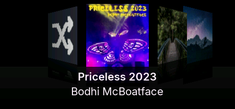
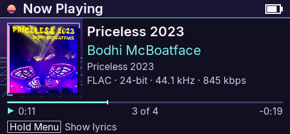
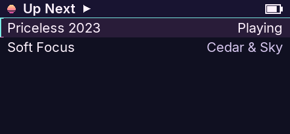
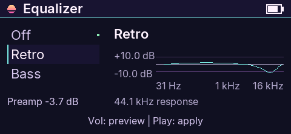

<p align="center"></p>
<h1 align="center">Gnarlyr</h1>
<p align="center"><strong>Your music. Your player.</strong><br>Open firmware for the full-size SNOWSKY (FiiO) ECHO.</p>
<p align="center">
  <a href="https://github.com/0xdoublesharp/gnarlyr/actions/workflows/ci.yml"></a>
  <a href="https://github.com/0xdoublesharp/gnarlyr/releases"></a>
  <a href="https://github.com/0xdoublesharp/gnarlyr/releases"></a>
  <a href="firmware/LICENSE"></a>
  <a href="https://gnarlyr.com"></a>
  <a href="https://gnarlyr.com/studio.html"></a>
  <a href="CONTRIBUTING.md"></a>
</p>
<p align="center"><a href="https://gnarlyr.com">Website</a> · <a href="https://gnarlyr.com/docs.html">Player guide</a> · <a href="https://github.com/0xdoublesharp/gnarlyr/releases">Downloads</a> · <a href="CONTRIBUTING.md">Contribute</a> · <a href="#support-gnarlyr">Support</a></p>

Gnarlyr adds Cover Flow, an editable play queue, mixtapes, language packs, and sound controls to the full-size ECHO. The same portable C application runs on the player and in an SDL simulator. An ARM emulator tests the firmware image.

<table>
  <tr><td></td><td></td></tr>
  <tr><td align="center"><strong>Cover Flow</strong></td><td align="center"><strong>Now Playing</strong></td></tr>
  <tr><td></td><td></td></tr>
  <tr><td align="center"><strong>Up Next</strong></td><td align="center"><strong>Equalizer</strong></td></tr>
</table>

*Simulator product images use a sample library.*

## What you can do

- Browse by album cover, artist, album artist, genre, folder, playlist, or favorite. Play individual CUE tracks.
- Reorder Up Next, save mixtapes, shuffle by song or album, and resume where you left off.
- Keep your place in podcasts and audiobooks, jump between audiobook chapters, and use spoken-word playback controls.
- Tune the sound with graphic or parametric EQ, ReplayGain, clipping prevention, and headphone profiles.
- Change the text size, screen orientation, theme, buttons, and language.
- Build, preview, and share custom theme packs in [Theme Studio](https://gnarlyr.com/studio.html).
- Pair Bluetooth headphones, copy music over USB, or use the player as a USB DAC.

See the [feature guide](https://gnarlyr.com/firmware.html) for details and [known issues](firmware/docs/known-issues.md) for device validation and remaining limitations.

## Get Gnarlyr

Find Gnarlyr Companion and firmware on [GitHub Releases](https://github.com/0xdoublesharp/gnarlyr/releases). See the [changelog](CHANGELOG.md) for firmware release history and upcoming changes.

### Gnarlyr Companion

Open [Companion 1.0.0-beta.4](https://github.com/0xdoublesharp/gnarlyr/releases/tag/desktop-v1.0.0-beta.4) and choose the installer for macOS (Apple Silicon), Windows (x64), or Linux (x86_64). Verify the download against `SHA256SUMS` in the same release. Use [Gnarlyr Companion](https://gnarlyr.com/companion.html) to install or update firmware, copy music, build mixtapes, manage themes and fonts, and install custom language packs.

### Gnarlyr firmware

Open [firmware v1.0.0-beta.4](https://github.com/0xdoublesharp/gnarlyr/releases/tag/v1.0.0-beta.4). Download `ECHOECHO.img` for a first install or an update. The release also includes `.gtheme` packs, matching source, and `SHA256SUMS`. Verify your downloads and follow the [installation guide](https://gnarlyr.com/install.html).

Choose from seven built-in languages in Settings → Language. You can add custom packs to internal storage with Companion or build your own with the [language-pack builder](https://gnarlyr.com/languages.html).

Gnarlyr supports the full-size ECHO with a 480 × 222 display. See the [download reference](docs/downloads.md) for asset details, and prepare the [recovery procedure for this model](firmware/docs/device-recovery.md) before a first install.

## Repository map

| Path | Purpose |
| --- | --- |
| [`firmware/`](firmware/README.md) | Portable C11 firmware, device drivers, SDL simulator, ARM emulator, tests, and architecture |
| [`site/`](site/README.md) | Gnarlyr.com: static HTML/CSS/JavaScript, guides, and product assets |
| [`tools/`](tools/) | Build wrapper, USB CLI/MCP operations, language tools, release preparation, and stock-image analysis |
| [`tests/`](tests/) | Root host-tool, parser/exporter, and website checks |
| [`docs/`](docs/) | Development, device protocols, downloads, and reference documentation |
| [`ghidra/`](ghidra/) | Stock-firmware analysis scripts |

The desktop companion has its own private [source repository](https://github.com/0xdoublesharp/gnarlyr-desktop).

## Building the firmware

From the repository root, check the prerequisites below and build the simulator or a firmware image.

```sh
python3 tools/firmware.py setup
python3 tools/firmware.py sim --card /path/to/music
python3 tools/firmware.py build --preset device
python3 tools/firmware.py build --preset release
```

The wrapper keeps build output in `/Volumes/Scratch/SnowskyEcho/build/` and separates builds, temporary files, and simulator state by Git worktree. These commands run on the computer without a connected player.

Run a focused test while editing. The smoke group checks playback, settings, queues, the updater, ARM boot, and module fallback.

```sh
python3 tools/firmware.py test --regex '^test_player$'
python3 tools/firmware.py test --group smoke
python3 tools/firmware.py test --group host --list
```

`--group host` selects native unit tests. `--list` shows the selected tests, fixtures, and build targets without compiling. See the [development workflow](docs/development.md) for the complete suite, parallelism options, and device checks.

### Prerequisites

- CMake, SDL2 development files, FFmpeg, and `clang-format`.
- Python 3.14 reproduces the checked-in Unicode sort tables. Install the packages in `firmware/tools/requirements.txt` into `/Volumes/Scratch/SnowskyEcho/tools/gnarlyr-python314`. Set `ECHO_VENV` to use a different Python 3.14 virtual environment.
- Arm GNU Toolchain 15.3.rel2 (GCC 15.3.1) for `arm-none-eabi`, expected under `/Volumes/Scratch/SnowskyEcho/tools/arm-15.3-expanded/Payload/bin`. Set `ECHO_ARM_BIN` to use another location. Check the macOS arm64 package against SHA-256 `779972fa545f738bfbba2ff0ae44d5ad7510b00cfb414702974844ba625412f3`, then unpack it with `pkgutil --expand-full`. [Download from Arm](https://gitlab.arm.com/api/v4/projects/tooling%2Fgnu-toolchains-for-arm/packages/generic/gnu-toolchain/15.3.rel2/arm-gnu-toolchain-15.3.rel2-darwin-arm64-arm-none-eabi.pkg).

## Contribute

Bug reports, focused fixes, translations, and clearer guides are welcome. See [CONTRIBUTING.md](CONTRIBUTING.md) for checks, commit conventions, and pull requests, and the [language-pack guide](docs/language-packs.md) for translation and display checks.

Report vulnerabilities with [private security reporting](https://github.com/0xdoublesharp/gnarlyr/security/advisories/new). Community expectations are in the [code of conduct](CODE_OF_CONDUCT.md).

## Support Gnarlyr

Gnarlyr is free and open source. If it makes your ECHO more enjoyable to use, you can support ongoing development through [GitHub Sponsors](https://github.com/sponsors/doublesharp) or [Venmo (`@doublesharp`)](https://venmo.com/u/doublesharp).

## Stock firmware analysis

The repository also contains tools for studying FiiO's stock image. See [the stock-firmware reference](docs/stock-firmware.md). Parser/exporter tests use Python's standard library:

```sh
PYTHONDONTWRITEBYTECODE=1 python3 -m unittest discover -s tests
```

Keep stock images, derived ELF files, Ghidra databases, private backups, and run evidence outside Git. A derived ELF is an analysis representation and must never be flashed.

## License and credits

Firmware is **GPL-3.0-or-later**. See [LICENSE](firmware/LICENSE), [CREDITS](firmware/CREDITS.md), and [UPSTREAM](firmware/UPSTREAM.md) for authorship, provenance, and bundled third-party licenses.

Gnarlyr builds on [Podium](https://podium-echo.online) and, through it, [EchoPod](https://github.com/BasilSkyWalk/echopod). Their authors' work forms the foundation of this project. SNOWSKY, FiiO, and ECHO belong to their respective owners; Gnarlyr is an independent project.
