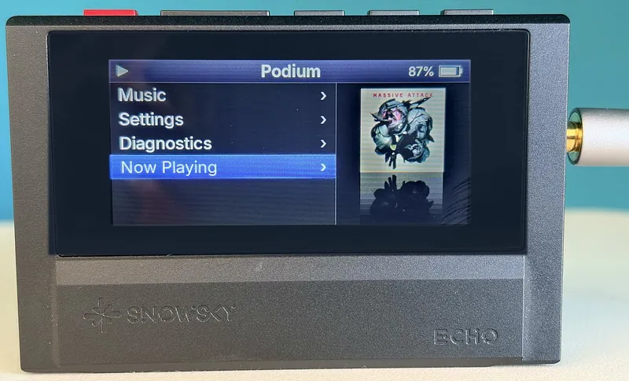
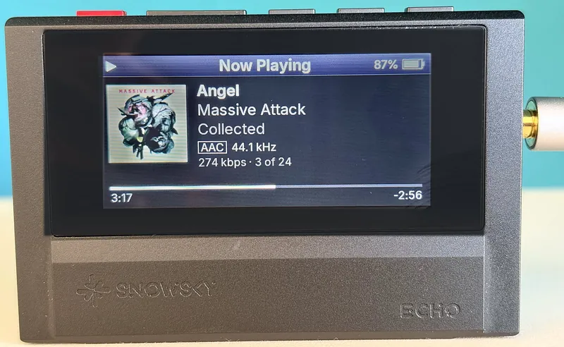
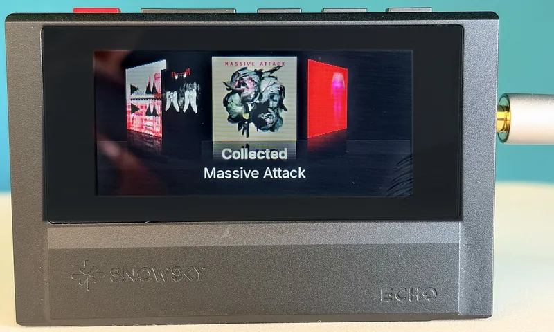

# Podium

Replacement firmware for the full-size Snowsky (FiiO) Echo music player (4 GB and 8 GB), forked from [EchoPod](https://github.com/BasilSkyWalk/echopod). It has an iPod-style UI with iPod-sized text, a Cover Flow browser, a music library built on the player, album favorites, M3U playlists and an Up Next queue. It isn't made or supported by FiiO.

<p>
  
  
  
</p>

## Install

Read [`docs/known-issues.md`](docs/known-issues.md) first. Replacing a player's firmware can leave it unable to start; recovery is in [`docs/device-recovery.md`](docs/device-recovery.md).

1. Download `ECHOV455.IMG` from [Releases](https://github.com/velppa/podium/releases) and check its SHA-256 against the one in the release notes.
2. Connect the Echo and copy the file to the root of its internal storage, not into a folder. Leave no other `ECHOVnnn.IMG` there.
3. Eject and unplug. The player shows "Updating firmware", installs Podium, deletes the file and restarts into Podium.

The first install goes through FiiO's own updater, later updates through Podium's; both take the same file copy. If FiiO's firmware comes back after a short "Updating" and the file is gone, nothing was written: copy it again with plenty of free space, or install through maskrom ([`docs/device-install.md`](docs/device-install.md)). Going back to FiiO's firmware is the same copy with FiiO's `ECHOV200.IMG`.

## Music formats and layout

Copy music over USB to a microSD card (FAT32 or exFAT) or, with no card in the player, to internal storage. Any folder layout works; the library is built from the tags, and rebuilt by itself after each USB session.

```
Music/
  Depeche Mode/
    Violator/
      01 World in My Eyes.flac     one file per track
      02 Sweetest Perfection.flac
      folder.jpg                   the album cover
    Songs of Faith and Devotion/
      Songs of Faith and Devotion.flac   the whole album in one file
      Songs of Faith and Devotion.cue    splits it into tracks
      cover.png
```

- **Formats:** FLAC, MP3 and WAV up to 192 kHz, and `.m4a` with AAC-LC or Apple Lossless. APE, DSD, WMA and the other formats FiiO lists appear in the library but don't play; Podium says so. HE-AAC and `.m4b` don't play ([`docs/known-issues.md`](docs/known-issues.md)).
- **FLAC:** up to 24 bit, mono or stereo, 44.1 to 192 kHz. Tracks of one album play without a gap.
- **CUE sheets:** a `.cue` next to an album stored as one FLAC, WAV or MP3 file turns it into a normal album with one track per CUE track. The sheet names the file (capitals don't matter), or has the same name as it (`Violator.cue` and `Violator.flac`). Titles and artists come from the sheet, the rest from the file's tags. Sheets that name several files, a missing file or a format the player can't play are ignored. Details: [`docs/user-guide.md`, CUE sheets](docs/user-guide.md#cue-sheets).
- **Covers:** the picture inside the album's first track, otherwise a JPEG or PNG named `cover`, `folder`, `front` or `albumart` in the album's folder (`folder.jpg`, `cover.png`, …). A picture inside the track wins, so a `folder.jpg` is only used when the tracks have none.
  - **Size:** the player shows covers at 112 px (128 px in the middle of Cover Flow), so anything from about 300 to 1,000 px square looks the same. Smaller than 112 px works but looks soft. A non-square picture is cropped to its centred square.
  - **Too big:** a JPEG or PNG may be up to 16,384 px on each side, with no limit in bytes; the player decodes a big JPEG at 1/2, 1/4 or 1/8 scale, and a big file only makes "Finding covers" take longer. A 16-bit PNG is held to 64 KB per row: about 10,900 px wide, or 8,190 px with transparency.
  - **Refused:** pictures over those limits, CMYK, 12-bit, lossless and arithmetic-coded JPEGs, WebP, GIF and BMP, and broken files. The album then has no cover (a plain placeholder), even when a `folder.jpg` sits next to a refused picture inside the track. Re-save such a cover as an ordinary JPEG and rescan (Settings → Rescan library).
- **Playlists:** `.m3u` and `.m3u8` anywhere on the card, under Music → Playlists.
- **Audiobooks and podcasts:** folders named `Audiobooks` and `Podcasts` at the top of the card get their own Home entries, with a bookmark per book and episode.
- Podium keeps its library in a hidden `/.echo` folder (about 110 MB). Deleting it rebuilds the library.

## More

- **Using it:** [`docs/user-guide.md`](docs/user-guide.md).
- **What's new:** [`docs/release-notes.md`](docs/release-notes.md).

The hardware knowledge it relies on comes largely from the [ReChord](https://github.com/brnomt/ReChord) project's research ([`docs/hardware.md`](docs/hardware.md), [`CREDITS.md`](CREDITS.md)).

## Build and run the simulator (macOS)

```sh
brew install cmake sdl2 clang-format arm-none-eabi-gcc arm-none-eabi-binutils
python3 -m venv .venv && .venv/bin/pip install -r tools/requirements.txt
cmake --preset dev
cmake --build --preset dev
ctest --preset dev
./build/dev/platform/sim/echo_sim
```

## Build on Windows

Install [MSYS2](https://www.msys2.org) and, in its CLANG64 shell, the packages `mingw-w64-clang-x86_64-{clang,compiler-rt,cmake,ninja,SDL2}` and `mingw-w64-clang-x86_64-arm-none-eabi-{gcc,binutils,newlib}`, plus Python 3 with `pip install -r tools/requirements.txt`. With `C:\msys64\clang64\bin` first on the PATH (and not `C:\msys64\usr\bin`, whose git ignores this repo's line endings):

```sh
CMAKE_GENERATOR=Ninja CC=clang cmake --preset dev
cmake --build --preset dev
ctest --preset dev
```

## Build the firmware

```sh
cmake --preset release
cmake --build --preset release
```

This writes `build/release/ECHOV455.IMG` (named after `PODIUM_VERSION`, 4.5.5). The `device` preset builds the same image with the developer Diagnostics rows. [`docs/device-install.md`](docs/device-install.md) covers installing builds during development.

## Use your music library in the simulator

```sh
mkdir -p build/system
./build/dev/platform/sim/echo_sim --card /path/to/music --system-dir build/system
```

The simulator behaves like the player: on the first start it creates `library.db`, `covers.bin` and the save files in the system folder, scans the music folder (every format stock lists, plus `.m3u`/`.m3u8` playlists) and finds the album covers. Settings → Rescan library scans again. The music folder is only ever read.

The PC tools still work and write the same formats ([`tools/library_index.py`](tools/library_index.py), [`tools/cover_export.py`](tools/cover_export.py)), but the player doesn't need them. To skip the scan on the player, **echo-sync** builds the library, the covers and the music fingerprint (`scan.bin`) on a computer, straight into the card's `/.echo` folder, so the player's check after USB finds nothing to rescan ([`docs/user-guide.md`, Build the library on a computer](docs/user-guide.md#build-the-library-on-a-computer)). Each release carries it as one file for Windows, macOS (Apple silicon) and Linux, with nothing to install, built by [`.github/workflows/echo-sync.yml`](.github/workflows/echo-sync.yml) with PyInstaller; from the source it's `tools/echo_sync.py E:`. To build the file yourself: `python -m pip install -r tools/requirements.txt -r tools/requirements-build.txt`, then `python -m PyInstaller --onefile --name echo-sync --paths tools tools/echo_sync.py`.

## Testing on a player

1. Install the firmware ([`docs/user-guide.md`](docs/user-guide.md), or [`docs/device-install.md`](docs/device-install.md) for development builds).
2. Put music on a microSD card (FAT32 or exFAT), in any folder layout, and insert it.
3. Switch on. The player creates `/.echo` on the card, scans it ("Scanning library", then "Finding covers") and shows "Library: N tracks, M covers".
4. After copying music over USB, eject both drives: the player rescans by itself. Settings → Rescan library does it on demand.

Nothing else on the card needs a computer. Covers come from art embedded in each album's first track (FLAC, MP3/WAV/DSF/DFF ID3, MP4, APE, WMA) or a `cover`/`folder`/`front`/`albumart` JPEG or PNG next to the tracks.

### Simulator keys

| Device button | Keyboard |
|---|---|
| Volume up (moves menus down) | Down arrow |
| Volume down (moves menus up) | Up arrow |
| Play | Return or Space |
| Menu | M or Tab |
| Back | Backspace or Escape |
| Power | P |

### Simulator options

| Option | Effect |
|---|---|
| `--scale N` | Window scale (default 3) |
| `--frames N` | Quit after N frames |
| `--headless` | No window |
| `--screenshot FILE.bmp` | Save the last frame on exit |
| `--card DIR` | Use DIR as the card root (read only) |
| `--system-dir DIR` | Read and write `/.echo/` (library database, resume, settings, favorites) in DIR |
| `--battery N` | Report N % battery in the header (default 80) |
| `--charging` | Report the battery as charging |
| `--keys LIST` | Play a key script, e.g. `down,down,play,back:long` (`up`, `down`, `play`, `menu`, `back`, `power`, each optionally `:long`) |

Headless runs use a virtual clock, so scripted screenshots are deterministic.

### Navigation

| Button | In lists | On Now Playing | While seeking |
|---|---|---|---|
| Volume up / down | Next / previous item (wraps on a single press, not while held) | Tap for volume; hold Vol+ for the next track, Vol− for the previous one | Forward / back 5 s per tap, 15 s steps while held |
| Play | Select (a song plays the list from that song); hold on an album to add or remove it from Favorites | Play / pause; hold to seek | Jump to the chosen time |
| Menu | | | |
| Back | Back; hold to go home | Back; hold to go home | Cancel |
| Power | Screen off or on; hold 2 s to turn off | Same | Same |

The screen turns off after the screen timeout or a tap of Power. With the screen off, Play pauses and resumes, a tap of vol± changes the volume and holding vol± skips tracks, all without waking the screen; Power turns it back on.

Home also lists Audiobooks and Podcasts when the card has an `Audiobooks` or `Podcasts` folder: every book and episode remembers where you stopped, plays in order, and hold vol± jumps 30 s forward or 15 s back. Books and episodes stay out of the Music lists ([`docs/user-guide.md`](docs/user-guide.md)).

Settings: Shuffle (Off / Songs / Albums), Repeat (Off / One / All), Sleep timer, Screen timeout, Brightness, Gain, Output and Start screen. They're saved in `/.echo/settings.bin` on internal storage (the same with or without a card), and favorites in `/.echo/favorites.bin`. Without `--system-dir` the simulator can't save, and says so. Playback resumes, paused, where it left off.

Music → Cover Flow shows your albums as covers, by album artist. Vol± move, Play opens the album, holding Play adds or removes it from Favorites, and Back leaves. Music → Playlists lists the M3U playlists the indexer found. Music → Favorites lists your favorite albums.

## Layout

See [`docs/architecture.md`](docs/architecture.md).

## License

GPL-3.0-or-later. See [`LICENSE`](LICENSE). The bundled Inter font is under the SIL Open Font License 1.1 ([`assets/fonts/inter/OFL.txt`](assets/fonts/inter/OFL.txt)), and so are the glyph packs rendered from it. The simulator's decoders (dr_flac, dr_mp3, dr_wav) are public domain or MIT-0 ([`third_party/dr_libs/LICENSE`](third_party/dr_libs/LICENSE)). The player's MP3 decoder is libmad, GPL-2.0-or-later ([`third_party/libmad/COPYING`](third_party/libmad/COPYING)).
