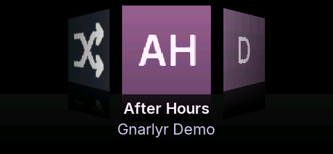
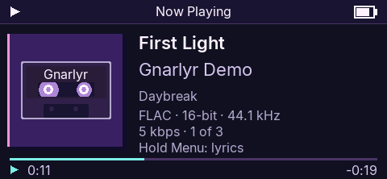
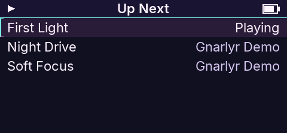
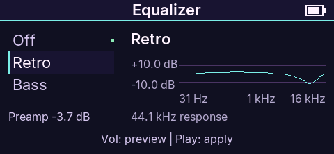

<p align="center"></p>
<h1 align="center">Gnarlyr</h1>
<p align="center"><strong>Your music. Your player.</strong><br>Open firmware for the full-size SNOWSKY (FiiO) ECHO.</p>
<p align="center">
  <a href="https://github.com/0xdoublesharp/gnarlyr/actions/workflows/ci.yml"></a>
  <a href="firmware/LICENSE"></a>
  <a href="https://gnarlyr.com"></a>
  <a href="CONTRIBUTING.md"></a>
</p>
<p align="center"><a href="https://gnarlyr.com">Website</a> · <a href="https://gnarlyr.com/docs.html">Player guide</a> · <a href="https://github.com/0xdoublesharp/gnarlyr/releases">Downloads</a> · <a href="CONTRIBUTING.md">Contribute</a></p>

Gnarlyr gives the ECHO a cover-led music library, a flexible play queue, mixtapes, language packs, and sound controls built for listening. The same portable C application runs on the player and in an SDL simulator, with an ARM emulator for full-image checks.

<table>
  <tr><td></td><td></td></tr>
  <tr><td align="center"><strong>Find your next favorite</strong></td><td align="center"><strong>Make yourself at home</strong></td></tr>
  <tr><td></td><td></td></tr>
  <tr><td align="center"><strong>Make the queue yours</strong></td><td align="center"><strong>Hear it your way</strong></td></tr>
</table>

*Simulator product images use a sample library.*

## What you can do

- **Browse your library:** album covers, artists, album artists, genres, folders, playlists, and favorites; CUE albums and audiobook chapters.
- **Shape a listening session:** reorder Up Next, save mixtapes, choose shuffle/repeat, and resume playback.
- **Tune the sound:** equalizer presets, a ten-band custom curve, ReplayGain, clipping prevention, and headphone profiles.
- **Make it yours:** text sizes, orientation, theme colors, configurable controls, and external language packs.
- **Connect your player:** Bluetooth headphones, USB file transfer, USB DAC mode, and validated firmware updates.

See the [feature guide](https://gnarlyr.com/firmware.html) for details and [known issues](firmware/docs/known-issues.md) for device validation and remaining limitations.

## Get Gnarlyr

Start with the [installation guide](https://gnarlyr.com/install.html). Published firmware and desktop installers will appear in [GitHub Releases](https://github.com/0xdoublesharp/gnarlyr/releases); release assets include checksums, and firmware ships with matching source. See [the download contract](docs/downloads.md) for website and installer URLs.

Gnarlyr 1.0.0 is in development. Public firmware release requires the player checks in [AGENTS.md](AGENTS.md) and owner approval. Only the full-size ECHO is supported; use the [exact-model recovery guide](firmware/docs/device-recovery.md) before installation.

## Repository map

| Path | Purpose |
| --- | --- |
| [`firmware/`](firmware/README.md) | Portable C11 firmware, device drivers, SDL simulator, ARM emulator, tests, and architecture |
| [`site/`](site/README.md) | Gnarlyr.com: static HTML/CSS/JavaScript, guides, and product assets |
| [`tools/`](tools/) | Build wrapper, USB CLI/MCP operations, language tools, release preparation, and stock-image analysis |
| [`tests/`](tests/) | Root host-tool, parser/exporter, and website checks |
| [`docs/`](docs/) | Development, device protocols, downloads, and reference documentation |
| [`ghidra/`](ghidra/) | Stock-firmware analysis scripts |

The [desktop companion](https://github.com/0xdoublesharp/gnarlyr-desktop) has its own private repository. Firmware, website, and public tooling stay together so protocol and documentation changes can land with their implementation.

## Building the firmware

```sh
python3 tools/firmware.py setup
python3 tools/firmware.py build --preset device
python3 tools/firmware.py build --preset release
python3 tools/firmware.py test
python3 tools/firmware.py sim --card /path/to/music
```

The wrapper checks its prerequisites, keeps all build output on the Scratch volume (`/Volumes/Scratch/SnowskyEcho/build/`, one directory per git worktree) and never touches a player. Focused tests build only their executable dependencies. Temporary files and simulator state are also separate for each worktree.

While editing:

```sh
python3 tools/firmware.py test --regex '^test_player$'
python3 tools/firmware.py test --group smoke
python3 tools/firmware.py test --group host --list
python3 tools/firmware.py build --target echo_sim
```

`--group host` selects native unit tests. `--group smoke` checks playback, settings, queues, the updater, ARM boot and module fallback. `--list` shows the selected tests, fixtures and build targets without compiling. An unmatched selection fails. Run `test --jobs 6` once after integration for the complete suite.

`--jobs N` sets build and test parallelism; `--build-jobs N` and `--test-jobs N` override them separately. See [development workflow](docs/development.md) for selection and dependency details.

Prerequisites:

- CMake, SDL2, FFmpeg and clang-format on `PATH`.
- Python 3.14. Its Unicode tables reproduce the checked-in sort tables; 3.13 and 3.15 do not. The wrapper expects a virtual environment at `/Volumes/Scratch/SnowskyEcho/tools/gnarlyr-python314` with `firmware/tools/requirements.txt` installed; set `ECHO_VENV` to use another.
- Arm GNU Toolchain 15.3.rel2 (GCC 15.3.1) for `arm-none-eabi`, expected under `/Volumes/Scratch/SnowskyEcho/tools/arm-15.3-expanded/Payload/bin`; set `ECHO_ARM_BIN` to use another. The macOS arm64 package is at [Arm's package service](https://gitlab.arm.com/api/v4/projects/tooling%2Fgnu-toolchains-for-arm/packages/generic/gnu-toolchain/15.3.rel2/arm-gnu-toolchain-15.3.rel2-darwin-arm64-arm-none-eabi.pkg), SHA-256 `779972fa545f738bfbba2ff0ae44d5ad7510b00cfb414702974844ba625412f3`. Check the digest, then unpack it with `pkgutil --expand-full`; no installer needs to run.

## Contribute

Bug reports, focused fixes, translations, and clearer guides are welcome. Read [CONTRIBUTING.md](CONTRIBUTING.md) for setup, checks, commit conventions, and pull requests. For translation help, include the English string and your proposed wording; preserve placeholders and check text fit on the player.

CI uses free standard GitHub-hosted runners: portable firmware, host-tool, and emulator checks with Clang on Linux, plus native FAT/exFAT mount/read/write checks on macOS for trusted main/release refs. A fast preflight checks tools and generated files, then six Linux shards cover the full test registry with their CTest fixtures. Pull requests run the Linux checks. Documentation-only changes skip expensive builds. Feature workers run focused tests; the integration owner runs one complete suite on the combined candidate. Build outputs, caches, and test captures stay on Scratch.

Report vulnerabilities with [private security reporting](https://github.com/0xdoublesharp/gnarlyr/security/advisories/new). Community expectations are in the [code of conduct](CODE_OF_CONDUCT.md).

## Stock firmware analysis

The repository also contains tools for studying FiiO's stock image. See [the stock-firmware reference](docs/stock-firmware.md). Parser/exporter tests use Python's standard library:

```sh
PYTHONDONTWRITEBYTECODE=1 python3 -m unittest discover -s tests
```

Keep stock images, derived ELF files, Ghidra databases, private backups, and run evidence outside Git. A derived ELF is an analysis representation and must never be flashed.

## License and credits

Firmware is **GPL-3.0-or-later**. See [LICENSE](firmware/LICENSE), [CREDITS](firmware/CREDITS.md), and [UPSTREAM](firmware/UPSTREAM.md) for authorship, provenance, and bundled third-party licenses.

Gnarlyr builds on [Podium](https://podium-echo.online) and, through it, [EchoPod](https://github.com/BasilSkyWalk/echopod). Their authors' work forms the foundation of this project. SNOWSKY, FiiO, and ECHO belong to their respective owners; Gnarlyr is an independent project.
