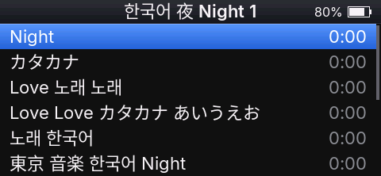

# Chinese, Japanese and Korean names

Podium releases show Chinese, Japanese and Korean (CJK) characters as `?`. This page is for people who want those names on the player: download the ready CJK image below, or build one yourself. Either way it is an unsupported image: the Podium author doesn't run it, and problems with it shouldn't be reported as Podium issues.

## Download the CJK image

[Download Podium 4.5.7 with CJK](download/4.5.7/cjk/ECHOV457.IMG): `ECHOV457.IMG`, 5,242,884 bytes, SHA-256 `3bc3e1c88ad73068e79b877758517dc0fff4b0f672e2d6d25691bb273149b0f4`.

It is Podium 4.5.7 with the recipe below applied, built from the 4.5.7 source. It passed the image tests in an emulator; it hasn't been run on a player. Install it as in [Install](#install). It carries glyphs rendered from Noto Sans CJK SC, licensed under the SIL Open Font License 1.1 (https://github.com/notofonts/noto-cjk/blob/main/Sans/LICENSE).

## Why releases leave CJK out

- **Size.** Latin, Cyrillic and the symbols Podium draws, at all three text sizes, take 211,294 bytes of glyphs in the image. The CJK set below (12,472 characters) takes 2,894,074 bytes at one size, 22 px, about 14 times more. The image is a fixed 5 MiB container, and the space it has for glyphs is about 3.8 MB in four separate areas, the largest 1.9 MB. CJK at 22 px fits only when split in two, and leaves about 0.7 MB.
- **One size only.** Settings → Text size has Small, Medium and Large (18, 22 and 26 px). CJK in each size would need about 2.0, 2.9 and 3.9 MB; the image has room for one. EchoPod drew CJK at 16 px (1,650,754 bytes), which looks small next to Podium's text.
- **Speed.** The player keeps 128 glyphs in memory, shared by all text. Latin names reuse a few dozen letters; a list of CJK names brings new characters on every row, and each new character is read from internal storage. Scrolling through CJK lists can be slower. This hasn't been measured on a player.
- **Code.** The player's code area is nearly full and shared with every new feature. The change below adds 40 bytes of code and uses 2.8 KB more of the glyph memory; the cache stays at 128 glyphs.

## What the recipe gives

- Korean: the 2,350 Hangul syllables of KS X 1001 (the common ones).
- Simplified Chinese: the 6,763 hanzi of GB 2312.
- Japanese: the kanji of JIS X 0208 (levels 1 and 2), hiragana and katakana.
- CJK punctuation and fullwidth forms.

The characters come from Noto Sans CJK SC at 22 px, the Medium text size.



## Build the image

The recipe targets Podium 4.5.6 and later (it needs the Text size setting's glyph faces). It was built and checked in the simulator and the image tests, not yet on a player. It changes four files: the glyph face list (`assets/fonts/glyph_pack.json`), the glyph generator (`tools/glyph_pack.py`) and two font files in `src/gfx`. `docs/cjk.patch` holds the change.

1. Get the source of the Podium release you run: the source zip next to the image on the Podium website, or a clone of the repository at the release tag (for example `git checkout v4.5.6`).
2. Install the tools from README.md, "Build and run the simulator" and "Build the firmware": cmake, the Arm GNU toolchain (`arm-none-eabi-gcc` and binutils), SDL2, clang-format and Python 3 with a virtual environment:

   ```sh
   python3 -m venv .venv && .venv/bin/pip install -r tools/requirements.txt
   ```

3. Download Noto Sans CJK SC Regular 2.004 (16,437,364 bytes) into `assets/fonts/noto-cjk/` and check its hash:

   ```sh
   mkdir -p assets/fonts/noto-cjk
   curl -L -o assets/fonts/noto-cjk/NotoSansCJKsc-Regular.otf \
     https://raw.githubusercontent.com/notofonts/noto-cjk/Sans2.004/Sans/OTF/SimplifiedChinese/NotoSansCJKsc-Regular.otf
   shasum -a 256 assets/fonts/noto-cjk/NotoSansCJKsc-Regular.otf
   ```

   On Linux use `sha256sum`. The hash must be `2c76254f6fc379fddfce0a7e84fb5385bb135d3e399294f6eeb6680d0365b74b`. The font is licensed under the SIL Open Font License 1.1 (https://github.com/notofonts/noto-cjk/blob/main/Sans/LICENSE), and so is everything rendered from it; keep that license with an image you share.

4. Apply the change (works in a git clone and in an unpacked source zip):

   ```sh
   git apply docs/cjk.patch
   ```

5. Render the glyph faces. On macOS with MacPorts, point the generator at FriBiDi as the tests do (`/opt/local/lib`; with Homebrew `/opt/homebrew/lib`). Without FriBiDi the image still works, but the Inter faces come out slightly different from the committed ones.

   ```sh
   DYLD_FALLBACK_LIBRARY_PATH=/opt/local/lib \
     .venv/bin/python tools/glyph_pack.py --config assets/fonts/glyph_pack.json --output src/fonts/packs
   ```

   It prints two new faces, `cjk_22_a: 6033 glyphs, 1,433,571 bytes` and `cjk_22_b: 6439 glyphs, 1,460,503 bytes`, each with "too big: none".

6. Build the image:

   ```sh
   cmake --preset release && cmake --build --preset release
   ```

   The last line reports `glyph faces 3,105,368 bytes`; the image is `build/release/ECHOVnnn.IMG` (`ECHOV456.IMG` for 4.5.6), 5,242,884 bytes like a release.

7. Optional: run the simulator with your music to see the names before installing (README.md, "Use your music library in the simulator").

### Tests that change

`ctest --preset dev` is not needed for the image. If you run it, these results are expected after the change:

- `test_font_pack` fails `a_font_falls_back_to_its_pack`: the test's made-up glyph pack uses CJK code points, which now go to the CJK faces.
- `tools_unit_tests` fails `test_the_echo_faces_hold_ascii_latin1_and_punctuation`: it expects only the Inter faces.
- `glyph_packs_up_to_date` passes once step 5 has run; it fails if the faces weren't regenerated, or if they were rendered without FriBiDi.
- Everything else passes, including the code and memory budget (`target_audit`) and the emulator tests of the image.

## Install

Install the self-built image as any Podium image: from FiiO's firmware as in [`docs/user-guide.md`, Install](user-guide.md#install), or over Podium as in [Updating Podium](user-guide.md#updating-podium). Podium installs any Podium image, whatever its version number. Keep a way back ([If something goes wrong](user-guide.md#if-something-goes-wrong)).

## Limitations

- One size: CJK stays 22 px at every text size. With Small it is larger than the Latin text around it, with Large smaller, and in the few places that use the 16 px small font it looks large.
- Regular weight only: titles in semibold show CJK in regular weight.
- Chinese glyph shapes: the font is the Simplified Chinese version of Noto Sans CJK, so some Japanese kanji are drawn in their Chinese form.
- Traditional-only Chinese characters, rare Hangul syllables, emoji and other scripts still show as `?`.
- Right after an update, until the player restarts, CJK characters not yet on screen show as `?`, as accented letters do.
- Sorting doesn't change: releases already order kana, Hangul and ideographs, with or without the glyphs.
- No support: questions and bugs about self-built images go to the person who built them.

## Going back to a release

Install the release image (`ECHOVnnn.IMG` from the Podium website) the same way, as in [Updating Podium](user-guide.md#updating-podium). The library, settings and favorites stay as they are.
