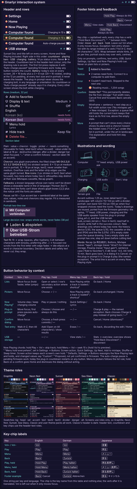
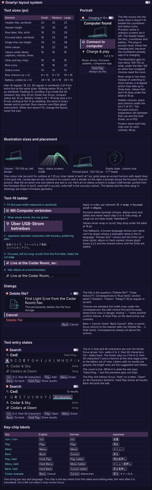
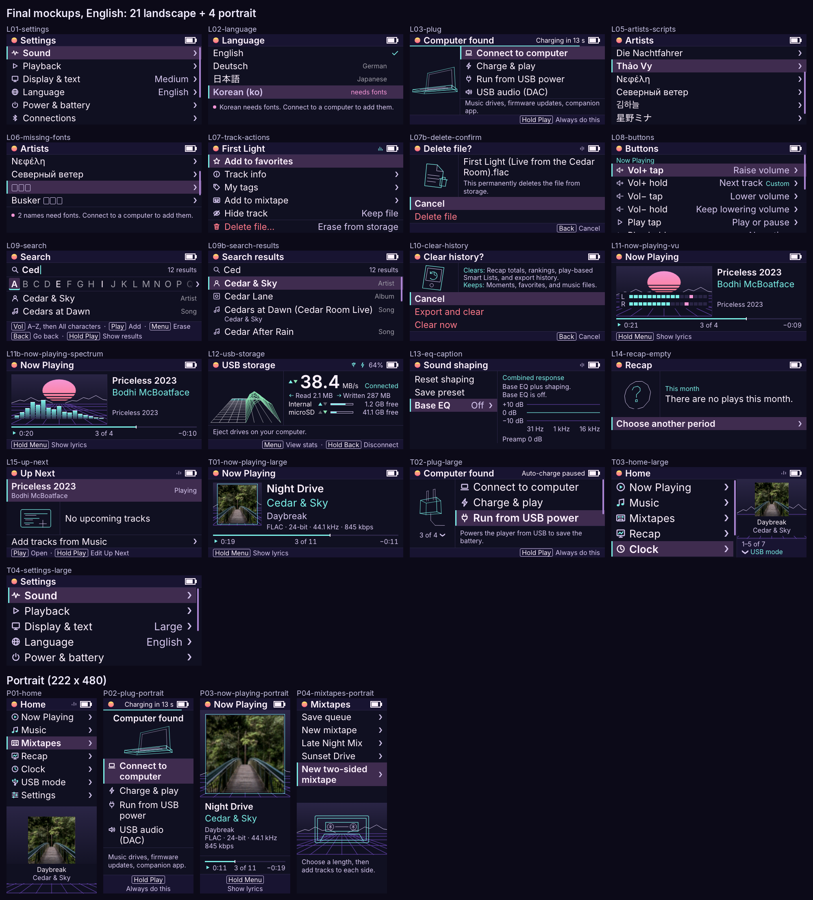
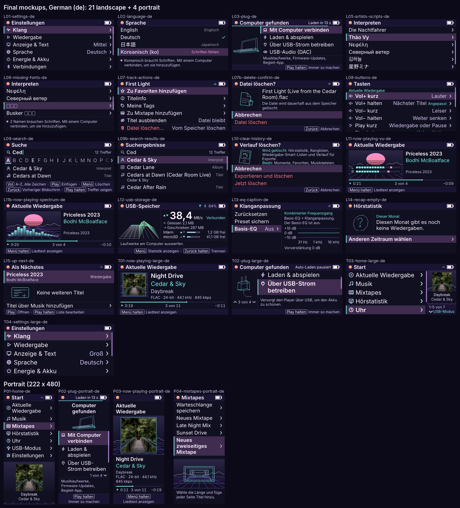
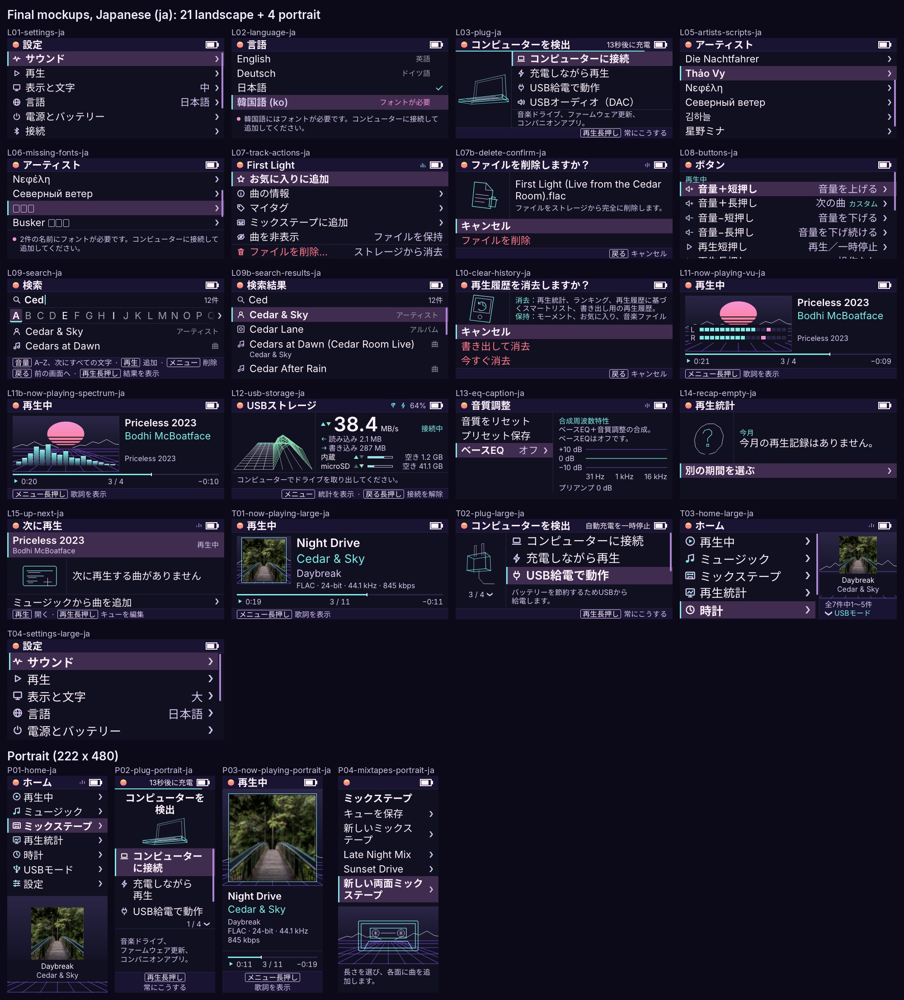

# Gnarlyr design system

This is the adopted design for Gnarlyr's screens. New and changed screens follow it. The two reference sheets and the three screen sheets in `design/` are the visual record; this text states the same rules in words. Where the text and a sheet seem to differ, the sheet is the record and this text needs correcting.

## Status

- Adopted on 2026-11-21.
- Deferred to beta.2 are the search letter strip, live preview, and results (L09/L09b), the EQ caption rewrite (L13), and the Recap empty-state art (L14).
- Also deferred: the file and history-device drawings beside the Delete file? and Clear history? confirms (L07b, L10). The confirm screen is built into the views and listening modules, and views has too little room left on the `device` image for both drawings. Mixtapes in portrait (P04) shows today's cassette art on the grid instead of a new wire cassette, without the help line under it.
- The sheets are HTML mockups rendered at the panel's real size (480 × 222 landscape, 222 × 480 portrait) in English, German and Japanese. They reuse some of today's firmware, such as the battery and the ported drawings, but the design as a set is not implemented yet. Where today's firmware behaves differently, [architecture.md](architecture.md) and [user-guide.md](user-guide.md) describe what it does now, and this document describes the target.
- Pending firmware work the design depends on:
  - **Plug-in countdown pause.** On the plug-in prompt, the first Vol press stops the countdown and the header says "Auto-charge paused". Today any button starts the 15 s count again ([user-guide.md](user-guide.md), When you plug in).
  - **Native-name glyphs in language packs.** Until a pack can draw a language's own name, Language shows a drawable name in the UI language, such as "Korean (ko)".
  - **Two-line rows, option A first.** A list decides once, on entry and from a width test, whether its rows are two-line, so all its rows stay the same height. True per-row heights (option B) are not the first step.
  - **Three-line rows.** Wrapped rows stop at two lines, so a portrait label that needs three (P04 in German) is cut with an ellipsis. A row whose value drops under its label keeps the label on one line.
  - **Button cells marked ³** in the [button table](#button-behaviour-by-context) are proposed and not confirmed in the firmware.
  - **Names.** The design says Settings → Buttons, and the firmware says Settings → Controls. The design's "Screen action" value for Menu hold everywhere is "Default" in the firmware (`STR_BUTTON_DEFAULT`).
  - **New strings.** Strings the mockups introduce, such as "Auto-charge paused" and "needs fonts", are not in `assets/lang` yet.

## Type and metrics

The typeface is Inter, at 16 px regular and at 18, 22 and 26 px regular or semibold. CJK comes from extra.font at the same sizes. Nothing is smaller than 16 px, and 16 px is never semibold. When text doesn't fit, change the layout, never the size.

| Element | Small | Medium | Large |
|---|---|---|---|
| Header title, semibold | 22 | 22 | 22 |
| Header height | 30 | 30 | 30 |
| Row label, title, artist | 18 | 22 | 26 |
| Focused label, semibold | 18 | 22 | 26 |
| Single-line row height | 24 | 32 | 38 |
| Inline values | 18 | 22 | 26 |
| Values under labels, captions, notices, times | 16 | 16 | 16 |
| Hints and key chips | 16 | 16 | 16 |
| Row icons | 18 | 18 | 22 |
| Status icons | 14 | 14 | 14 |
| Row chevron (w × h) | 8 × 13 | 8 × 13 | 10 × 16 |
| Battery, visible (w × h) | 29 × 16 | 29 × 16 | 29 × 16 |

All sizes are in px.

- **Padding:** 12 px.
- **Scrollbar:** a 4 px thumb inside the list viewport.
- **Key chip:** a 20 px box.
- **Footer line:** 24 px. A stacked portrait footer is 48 px.
- **Compact status bar:** 22 px.
- **Battery:** today's 26 × 16 body plus a 3 × 8 nub, 29 × 16 visible. It ends at the 12 px padding and is the same size in every header, at every text size and in portrait.
- **Secondary text at Large:** stays 16 px.

## Header

- Every screen has a title, Home and Now Playing included. The Sunset Disc comes first, then the title, both on the left.
- The right side holds, in this order:
  - the countdown, on timed screens;
  - playing bars, on screens other than playback while music plays;
  - USB;
  - charging;
  - battery.
- Status icons are 14 px.
- The header never shows ▶. Now Playing shows the play state beside the elapsed time.
- The battery never leaves the header.
- The countdown text uses the header-text colour. Only the draining rule under the header uses the accent.
- The plug-in prompt never shows the charging bolt, in any language or orientation, because its countdown or "Auto-charge paused" already says the player is charging. Every other screen shows the bolt while charging.
- When the title doesn't fit beside the countdown and status icons in portrait, it moves into the body (see [Portrait](#portrait)).
- The USB storage screen also shows a battery percentage beside the battery. The firmware's other optional status items, such as clock, volume and queue position, are not shown on the sheets.

## Rows and focus

**Focus.** A focused row has three marks:

- the selection fill;
- a 3 px accent bar at its left edge;
- a semibold label at the same size.

Values, notes and chevrons stay regular. Fit is measured with the semibold face.

**Row types.**

| Type | Rule |
|---|---|
| Plain | Label only. |
| Value + chevron | The value is at row size in text2, followed by the chevron. |
| Toggle | Value only ("Off"), with no chevron. |
| Picker | The current choice has an accent ✓. |
| Needs something | The label is text3 at rest and text2 when focused, so it stays readable on the fill. It is focusable for help only. Its note ("needs fonts") is 16 px in the alt colour. |
| Value under label | When the label and value don't fit side by side, the value drops under the label at 16 px in text2 and the row grows. Values never wrap or scroll. |
| Destructive | Danger colour after a divider, with a danger bar when focused. The label ends in "…" when another confirm follows ("Delete file…"). |
| Changed mapping | Marked with an accent word, "Custom" (Buttons). |
| Section label | 16 px regular in the accent colour ("Now Playing", "Every screen"). |

**Chevron.** There is one glyph everywhere: the filled shape `M0 0h3.2L8 6.5 3.2 13H0l4.8-6.5Z`, with no stroked variant. It is 8 × 13 px at Small, Medium and in portrait, and 10 × 16 px at Large. It is text2 and never smaller than the Medium size. Overflow cues and the edges of the search letter strip use the same glyph, turned.

**Row icons.**

- Strokes are 2 px. Icons are text2, and text when the row is focused.
- Icons are two-tone where today's icon is.
- Silhouettes stay distinct at their size: the Mixtapes cassette and the Recap graph must not look alike.
- No icon is thinner than today's.

**Scrollbar.** The thumb sits inside the list viewport and ends above any notice band.

**Fallbacks.**

- A known language whose own name can't be drawn shows a drawable name in the UI language ("Korean (ko)", "Koreanisch (ko)", "韓国語 (ko)").
- Library text the fonts can't draw (artist, album or track names) shows glyph boxes (□□) in text2, plus the shared notice until the fonts are added.

## Footer hints

A hint is a key chip followed by a capitalised verb, with no separator between them ("Hold Back Disconnect"). Every chip has a verb. As drawn, the verb never repeats the chip's word (de "Zurück Vorheriger Bildschirm", ja "戻る 前の画面へ").

- " · " separates hints.
- The order is move · act · back · hold.
- Leave Vol out when it only moves focus.
- Text entry is the one exception: it shows Vol with its range instead of a verb ("Vol A–Z, then All characters").
- Lines wrap only between whole hints, at 24 px per line.
- In portrait, each chip is stacked over its verb, centred.
- The footer uses the header's colours.

Use the label from this table for each chip and nothing else. The verb after the chip is translated.

| Key | English | German | Japanese |
|---|---|---|---|
| Vol+ / Vol− | Vol | Vol | 音量 |
| Play | Play | Play | 再生 |
| Menu | Menu | Menü | メニュー |
| Back | Back | Zurück | 戻る |
| Play, held | Hold Play | Play halten | 再生長押し |
| Menu, held | Hold Menu | Menü halten | メニュー長押し |
| Back, held | Hold Back | Zurück halten | 戻る長押し |
| Footer example | Back Cancel | Zurück Abbrechen | 戻る キャンセル |

The Buttons list uses the same key names in its row labels.

Footers appear only on:

- prompts;
- confirms;
- text entry;
- USB;
- Quick Settings;
- Up Next;
- Now Playing's hold cue ("Hold Menu Show lyrics", shown only while Menu hold is assigned to Lyrics, which is the default).

Footers never appear on plain lists or pickers.

## Dialogs and feedback

**Confirm.**

- The title is the question ("Delete file?", "Clear history?").
- The consequences come first, in 16 px text2. Section labels ("Deletes", "Clears", "Keeps") are 16 px regular in the accent colour.
- The choices are standard full-width rows under the consequences. The safe choice comes first and is focused.
- Destructive rows are in the danger colour and end in "…" when another confirm follows.
- A fresh Play on the destructive row commits.
- Back cancels, and the footer says "Back Cancel".
- After a cancel, focus returns to the nearest safe row (Delete file… → Hide track).
- The consequences always sit above the actions.

| Pattern | Rule and example |
|---|---|
| Toast | A short confirmation: "Added to favorites". |
| Notice | An alt-colour dot and a sentence that names the next step: "2 names need fonts. Connect to a computer to add them." Count the affected names, not glyphs. Up to two lines. |
| Error | What happened and what the player did: "Couldn't read track. Skipped to the next one." |
| Wait | Says what is happening, with progress: "Reading music… 1,204 songs". A count that is out of date says "Searching…", and its previews grey out. |
| Empty | A wireframe, a sentence and the next step as a full-width action row ("No mixtapes yet." → New mixtape). The exception is a queue that still holds the current track: it keeps that track as its first row, above the empty state. |
| More | A prompt that can't show every choice shows its place and a chevron toward the hidden rows ("1 of 4"). In portrait it goes under the list; in landscape, under the art. The focused choice's explanation and the hold hint stay visible. |

## Illustrations

**Drawing rules.**

- Outlines are accent at 1.25 px.
- Inner detail is text2 at 1 px, and far edges are dimmer.
- Grids keep an accent horizon, with depth lines in the grid role.

**Today's drawings, ported from the firmware geometry and kept:**

- From the plug-in prompt (`plug_art.c`): the laptop, the polygon "?" head, USB power, charging, and the USB-audio speaker with its sound arcs.
- The start/stop wireframe.
- The USB terrain (`usb_screen_terrain.c`): floor in text3, read half in the accent colour, write half in the success colour.
- The striped Sunset Disc and the grid.

**New drawings, only where today has none:**

- the history device (Clear history);
- the queue (Up Next, also its empty state);
- the cassette on the grid (Mixtapes in portrait);
- the file (Delete file?).

**Placement.**

| Use | Size and place |
|---|---|
| Landscape column | 112–124 px wide, on the left, art centred, with a divider on its right |
| Hero (status screens) | The USB terrain; as drawn, 182 × 124 px on the layout sheet and 174 × 121 px in the USB storage art cell |
| Portrait band | Its own band under the title, 120–132 px wide; 100 px when four wrapped choices need the room |
| Empty state | Column size; the "?" head unless the screen has its own drawing |

- Every empty state and prompt has a drawing.
- A prompt shows the picture for the focused choice.
- Step the art down one size before any text is cut.

## Text fit

Apply these steps in order, to each element:

1. **Fit.** The focused width is measured in semibold.
2. **Wrap.** Wrap whole words at spaces and after hyphens, and the row grows. Japanese and other CJK text breaks between characters with kinsoku rules, preferring a break after 、.
3. **Scroll.** A focused row that is still too long scrolls from its first letter, with fades at the cut edges.
4. **Ellipsis.** An idle row is cut with an ellipsis at a word or character boundary.

Decision labels (prompt choices, dialog rows) and safety text never reach step 3 or 4. They wrap, at Large too: there is no fade inside a word such as "betreiben". Values never wrap or scroll; they drop under their label at 16 px.

## Portrait

- **Title.** It moves into the body when it doesn't fit beside the countdown and status icons. Prompts centre it, and ordinary screens set it left. The header keeps the disc, the countdown and the battery.
- **Art.** It gets its own band under the title, 120–132 px wide, or 100 px when four wrapped choices need the room.
- **Rows.** They wrap to two lines instead of switching to short names, and a wrapped action may take up to three lines. Values that don't fit drop under the label at 16 px.
- **Hidden choices.** The place and a chevron ("1 of 4") go under the list. The focused choice's explanation sits between that cue and the hold footer.
- **Footers.** Each chip is stacked over its verb, centred.

## Large text

- **Sizes.** Rows are 38 px, labels and values 26 px, row icons 22 px and chevrons 10 × 16 px. Secondary text stays 16 px, and the header is unchanged.
- **Decision labels.** They wrap as whole words and never fade.
- **Hidden prompt choices.** When not every choice fits, the column under the art shows the place ("3 of 4") with a chevron toward each hidden side. The explanation and the hold hint stay visible.
- **Continuation cue.** A list that continues below shows a cue ("1–5 of 7", then the next row's name) on a solid surface, with the chevron turned down.
- **Focus bar.** It starts inside the content area.
- **Now Playing.**
  - The album is 22 px regular in text2.
  - The format line is 16 px ("FLAC · 24-bit · 44.1 kHz · 845 kbps").
  - The hold cue appears only while Menu hold is assigned to Lyrics.

## Words and formats

| Use | Never |
|---|---|
| Recap (de Hörstatistik, ja 再生統計) | — |
| Buttons | Controls |
| Mixtape | tape |
| storage, for internal storage | drive |
| Preamp | Input gain |
| Sentence case: "Add to favorites" | — |
| 0 dB | -0.0 |
| 44.1 kHz, 15 min | — |
| ja コンピューター | パソコン |

- "Music drives" in the plug-in explanation stays: it names the drives the computer sees.
- A count keeps one number and one noun from search to its results ("12 results").
- The artist line is in the accent colour on every Now Playing style.
- Now Playing shows an album line and reserves two lines for the artist.
- Back goes back. In a dialog it is Cancel. On the plug-in prompt it is Charge & play, the one named exception.

## Button behaviour by context

| Context | Vol+ / Vol− | Play tap / hold | Menu tap / hold | Back tap / hold |
|---|---|---|---|---|
| Lists | Move focus (hold: faster, letter jumps) | Open or select / the row's secondary action where one exists | Now Playing while a track is loaded / shortcut¹ | Go back / Home |
| Pickers | Move focus | Choose ✓ / — | Now Playing while a track is loaded³ / shortcut¹ | Go back unchanged / Home |
| Now Playing² | Volume step / keep changing volume | Play or pause / nothing | Quick Settings / Lyrics | Go back / Home |
| Plug-in prompt | Move focus; the first press pauses auto-charge³ | Choose / choose and always do this | — / — | Charge & play, the named exception: Back chooses Charge & play instead of going back / —³ |
| Confirm dialog | Move focus | Choose; a fresh press commits / — | — / — | Cancel / Home, dismissing the dialog³ |
| Text entry | Walk A–Z, then All characters | Add (Open on All characters) / show results | Erase / — | Go back, discarding the edit / Home |
| USB storage | — | — / — | View stats / — | Stats → overview; the overview shows "Hold Back Disconnect" / disconnect |

Now Playing chords: hold Play + Vol skips a track; hold Menu + Vol seeks 10 s, and holding Vol previews.

¹ "Menu hold everywhere", set in Settings → Buttons: Screen action, Quick Settings, Up Next, Add to mixtape, Shuffle or Sleep timer. Screen action keeps each screen's own hold.

² Defaults. Settings → Buttons reassigns the Now Playing taps and holds, and a changed value says "Custom".

³ Proposed, not yet confirmed in the firmware. The auto-charge pause is pending firmware work. Menu in pickers follows the list rule. Hold Back on a confirm goes Home and dismisses the dialog without acting.

**Text entry.** The A–Z strip and All characters form one Vol-driven focus group: Vol+ walks A to Z, then All characters, and Vol− walks back. A chevron at the strip's edge points to the letters out of view. Letters with no results are greyed; the bright ones are the suggested next letters. The count is live. The Play hint follows focus: "Add" on a letter, "Open" on All characters.

## Themes

Screens use colour roles only, so Graphite, Neon Noir, Sunset, Sea Glass, Classic and user theme packs all work. The mockup roles and the `ThemeColors` fields they correspond to:

| Mockup role | `ThemeColors` field | Use |
|---|---|---|
| bg | `background` | Screen background |
| head | `header_background` | Header and footer surface |
| sel | `selection_background` | Focus fill |
| accent | `accent` | Focus bar, section labels, ✓, artist line, outlines, draining rule |
| text | `text` | Labels |
| text2 | `text_secondary` | Values, chevrons, row icons, captions, inner detail |
| text3 | `text_tertiary` | Needs-something labels at rest, terrain floor |
| divider | `divider` | Rules between areas and before destructive rows |
| danger | `danger` | Destructive rows and their focus bar |
| alt | `accent_alt` | Notes and notice dots |
| thumb | `scrollbar_thumb` | Scrollbar |
| success (not a mockup stylesheet role; the terrain drawing uses it directly) | `success` | Terrain write half |
| header text | `header_text` | Header title, countdown, key chips |
| grid | none | Grid depth lines |
| header text, secondary | none | Header status text, chip outlines, footer verbs |

- In the mockups, the selection fill for every theme is `selection_background` mixed 10 % toward `selection_top`.
- Classic's header is dark, so its header text, countdown and key chips use the header-text roles.

**Contrast.** The ratios below were computed with the WCAG relative-luminance formula from the mockup colour values. They are mockup measurements, not checks of the firmware's themes.

| Theme | text / bg | text2 / bg | text3 / bg | accent / bg | sel / bg | text / sel | danger / sel | header text / head | accent / head |
|---|---|---|---|---|---|---|---|---|---|
| Neon Noir | 17.45 | 11.87 | 6.78 | 13.72 | 1.51 | 11.59 | 4.99 | 16.49 | 12.97 |
| Graphite | 16.90 | 8.76 | 4.82 | 8.00 | 1.44 | 11.76 | 3.54 | 16.03 | 7.59 |
| Sunset | 15.82 | 11.67 | 8.60 | 9.39 | 1.63 | 9.69 | 5.65 | 14.06 | 8.34 |
| Sea Glass | 16.05 | 11.68 | 9.15 | 11.21 | 1.78 | 9.02 | 5.21 | 13.96 | 9.74 |
| Classic | 12.66 | 6.32 | 5.30 | 4.01 | 1.29 | 9.84 | 4.80 | 13.00 | 2.96 |

- The review of today's simulator captures measured text at 17.5:1 and the old selection fill at 1.18:1 against the background, in the default theme. That old fill is why the adopted fill is lifted and focus also uses the bar and a semibold label.
- Classic's accent on its dark header is 2.96:1. That is why the countdown uses the header-text colour and only the draining rule uses the accent.

## Screens

Each screen is on the contact sheet for its language, labelled with the ID below. Every screen shows one state at Medium text (L, P) or Large text (T).

| ID | Screen | State shown and rules it demonstrates |
|---|---|---|
| L01 | Settings | Grouped categories with icons. Language is fourth, About last, and the thumb shows more rows below. No footer. |
| L02 | Language | Korean (ko) focused as a needs-fonts row, with a drawable fallback name and the next-step notice |
| L03 | Plug-in prompt | Countdown running and Connect to computer focused. The art follows the focused choice, the explanation is below the rows, and the footer reads Hold Play Always do this. |
| L05 | Artists, several scripts | Latin with Vietnamese, Greek, Cyrillic, Korean and Japanese names. This depends on the built-in fonts and extra.font. |
| L06 | Missing fonts | Glyph-box rows, a two-line notice counting names, and the scrollbar ending above the notice |
| L07 | Track actions | First row focused. Values inline, a divider before Delete file… in the danger colour, and playing bars in the header. No footer. |
| L07b | Delete file? | File wireframe, wrapped file name, consequence, then Cancel (focused) and Delete file, with Back Cancel |
| L08 | Buttons | "Now Playing" section label, Vol+ tap focused, and a changed mapping marked Custom. "Every screen" with Menu hold everywhere is further down. |
| L09 | Search | Letter strip as one focus group, live count, two previews with kind labels, and a two-line footer |
| L09b | Search results | Mixed Artist, Album and Song results, the same count as L09, and a long title and artist wrapping in one row |
| L10 | Clear history? | Clears and Keeps above full-width Cancel (focused), Export and clear, and Clear now, with Back Cancel |
| L11 | Now Playing, VU meters | Striped Sunset Disc behind the meters, accent artist line, album line, play state by the elapsed time, and the hold cue |
| L11b | Now Playing, Spectrum | Same metadata and transport as L11 |
| L12 | USB storage | Terrain hero, rate with read and write arrows, per-drive indicators, the eject sentence, and Menu View stats · Hold Back Disconnect |
| L13 | Sound shaping | Caption heading in the accent colour that says what the graph combines, "0 dB" and Preamp. No footer. |
| L14 | Recap, empty | "?" head, the message for the selected period, and Choose another period as a full-width row |
| L15 | Up Next, empty | The current track kept as the first row, the queue drawing, and Add tracks from Music as a full-width row, with Play Open · Hold Play Edit Up Next |
| T01 | Now Playing, Large | 22 px album in text2, 16 px format line, and the hold cue |
| T02 | Plug-in prompt, Large | Auto-charge paused, Run from USB power focused, USB power art, and the "3 of 4" cue under the art. No bolt. |
| T03 | Home, Large | Clock focused, and the "1–5 of 7" cue on a solid surface pointing to USB mode |
| T04 | Settings, Large | Grouped categories, 26 px text2 values, and the focus bar inside the content area |
| P01 | Home, portrait | Loaded-track order with Now Playing first, and two-tone icons |
| P02 | Plug-in prompt, portrait | Title in the body, centred; the laptop band; wrapped rows; the "1 of 4" cue in de and ja; and a stacked, centred footer |
| P03 | Now Playing, portrait | Title, artist, album and format line under the cover, with a stacked, centred hold cue |
| P04 | Mixtapes, portrait | Saved mixtapes above the cassette, and a focused action wrapped to two lines (three in German). No footer. |

